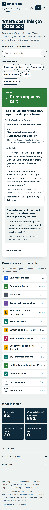
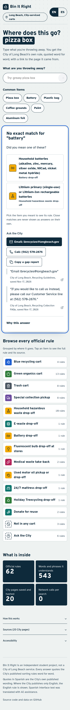
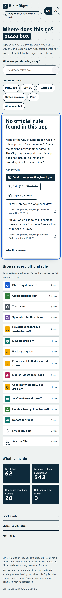
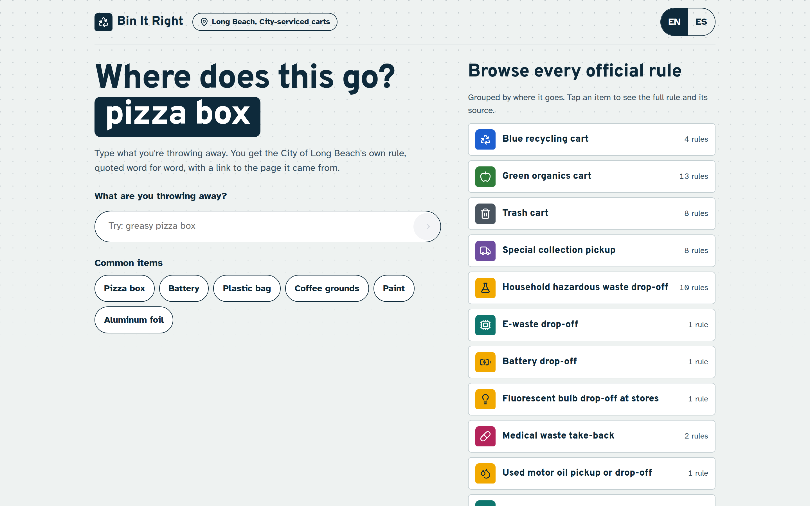

# Bin It Right

[](https://github.com/bananatruck/bin-it-right/actions/workflows/ci.yml) [](https://github.com/bananatruck/bin-it-right/actions/workflows/pages.yml)

Which Long Beach cart does it go in?
Bin It Right answers with the City of Long Beach's own published rule, quoted word for word, with a link to the City page it came from and the date that page was saved.
When none of the City rules in the app match an item, it says so and gives you the City's email and phone number instead of guessing.

**Live app:** https://bananatruck.github.io/bin-it-right/

Built for the Theme Track, "Rethinking Waste", of [Arbiter Hacks V1](https://arbiter-hacks-v1.devpost.com/).

<p>
  
  
  
</p>



## The problem

Long Beach homes with City service have three carts: blue for recycling, green for organics, and trash.
The City publishes clear rules for each, but they are spread across bilingual PDF flyers and more than a dozen web pages, and some items go to none of the carts (batteries, paint, sharps, mattresses).
When residents guess, recyclables and compost get contaminated, and hazardous items end up in the trash.
Generic "is this recyclable?" tools answer from general knowledge, which can contradict the local rules: Long Beach, for example, sends products labeled compostable to the trash, not the green cart.

## What it does

- Answers "which bin?" for 62 items and categories, each one an official City of Long Beach rule.
- Shows the destination as a large slab in the cart's colour, with an icon and a text label, so colour is never the only signal.
- Quotes the City's wording exactly, with the page title, a link, and the date the page was saved.
- Adds the City's own tips (such as "Lids On!" and "Flatten Boxes!") and how to use the destination (pickup forms, drop-off sites, hours).
- Asks "Did you mean" for ambiguous or misspelled words, and never turns a close match into an answer on its own.
- Says "No official rule found in this app" when none of the City rules it includes match, with a ready-made question to send the City; the City may have guidance the app does not include.
- Shows the City's own Spanish wording where the City publishes it, and says plainly when a rule exists in English only.
- Lets you browse every rule by destination, see every saved source page, and open "Why this answer" to see exactly how your words were matched.
- Works offline after the first visit, with no accounts, no tracking, and no AI model at runtime.

## Where the rules come from

Every rule comes from a page or PDF published by the City of Long Beach Energy and Environmental Services Department, fetched on 2026-11-17 (Pacific time).
The City publishes item-level guidelines for all three carts as bilingual English and Spanish PDFs, and web pages for organics, household hazardous waste, e-waste, batteries and bulbs, medical waste, paint, used motor oil, tires, special collections, the 24/7 mattress drop-off, holiday tree recycling and donations.
That is enough detail to answer common questions from the City's own words, so Long Beach was chosen over Los Angeles County guidance.

| | |
|---|---|
| Official rules | 62 |
| City pages and PDFs saved | 20 |
| Search terms (English and Spanish) | 543 |
| Rules with the City's own Spanish wording | 13 |

Each source in `src/data/sources.json` records its URL, title, format, fetch time, the SHA-256 hash of the bytes fetched, and the path of its text snapshot in `data/snapshots/`.
Each rule in `src/data/rules.json` records its destination, one or more evidence quotes, optional tips, and the search terms that select it.

The rules apply to City-serviced accounts.
The City says that residents served by a permitted private hauler should contact that hauler, and the app shows this note, with the City's sentence, on every answer.

## How trust is enforced

These checks run in CI on every push to `main` and on every pull request, and the build fails if any of them fails:

- Every rule has at least one English evidence quote, and every quote names a source that exists.
- Every quote appears in its saved City page, word for word, after only Unicode compatibility normalisation (NFKC, which turns a printed "fi" ligature into "fi") and whitespace collapsing.
- Every source is an official `www.longbeach.gov` URL with a fetch time, a hash, and a saved snapshot whose header repeats the URL and hash.
- A Spanish label is allowed only if the City's own Spanish quote for that rule contains it.
- No search term selects two different rules.
- Every listed term returns its own rule as an exact answer.
- Every source is cited at least once.
- No quoted "Month D, YYYY" date is earlier than the day its page was saved, so past events in a City "Upcoming Dates" list are not shown as upcoming.

There is a test named "fails if any rule lacks a source" that removes the evidence from each rule in turn and checks that validation fails.

The dataset was written by hand from the saved pages and then audited against them by a second model (see "How it was built").
The audit mostly flagged search terms broader than the City's wording (such as "can", "paper" and "AA battery"); those were removed or narrowed.
Six rules were added after it: three split out of broader rules (computers, monitors and TVs; broken fluorescent bulbs; bundled tree branches) and three items the audit found in the pages (clean wood, nursery pots and tags, extra food to donate).
Items the City excludes from a cart without saying where they go (for example cacti, tree stumps, carpet, cooking oil and broken fluorescent bulbs) go to "Ask the City", with the City's contact route, instead of a guessed destination.

## How matching works

Matching is deterministic and runs entirely in the browser.

1. Normalise: Unicode decomposition, accents removed, lowercase, punctuation to spaces.
2. Drop a short listed set of filler words such as "the", "my", "old", "empty", "el", "de".
3. Make each word singular with a small listed rule set (`boxes` to `box`, `batteries` to `battery`, `botellas` to `botella`), with exceptions such as `glass` and `mattress`.
4. Exact match against the explicit term list: that is the only way to get an answer.
5. Otherwise score every term by the best of three measures: whole-phrase Damerau-Levenshtein similarity; how much of the term appears in the query (a typo-tolerant word counts by its similarity); and how much of the query appears in the term, weighted 0.85 (an exact word counts 1, a typo-tolerant word 0.95).
6. Terms scoring 0.8 or more are offered as "Did you mean", one per rule, at most five, in a fixed order.
7. Nothing at 0.8 or above means "No official rule found in this app".

The "Why this answer" panel under every result shows the normalised text, the ignored words, the matched term or the closest terms with their scores, and the threshold.
The engine is in `src/engine/`, with unit tests and tests against the real dataset (for example "battery" offers both household and lithium batteries, "glass" ranks glass rules above "grass", and "aluminum foil" returns no rule).

## Accessibility

- Buttons and links are at least 48 CSS pixels tall (the language and browse source buttons also at least 48 wide); search text is 17 px.
- Every destination has a text label and an icon as well as a colour; text contrast meets WCAG AA.
- After a search, a one-line status ("item: destination") is announced and focus moves to the labelled answer region; the destination is part of the answer's heading.
- The rotating headline word is hidden from screen readers, and under `prefers-reduced-motion` the headline, counters and answer reveal are static.
- The page language attribute follows the language switch, and each quote is marked with its own language.
- Spanish interface text was translated with AI assistance and has not yet been reviewed by a native speaker; City rule text is never translated.

## Run it

Requirements: Node 24 or newer and pnpm 10.

```sh
pnpm install
pnpm dev            # local development server
pnpm check          # lint, type-check, tests, production build
```

Other commands:

```sh
pnpm test           # engine, dataset provenance, UI, service worker and source fetcher tests
pnpm build && pnpm preview --port 4791 &
pnpm screenshots    # headless Chromium screenshots into docs/screenshots/
pnpm sources:fetch  # re-fetch every City page (needs network and pdftotext)
```

`pnpm sources:fetch` rewrites `data/snapshots/` and `src/data/sources.json` with new fetch times and hashes.
If the City changes a page, the provenance tests then fail on any quote that no longer matches, which shows exactly which rules need review.

## Project layout

```
src/data/        schema, sources manifest, rules, destinations, validator and dataset tests
src/engine/      normalisation, similarity, matcher and their tests
src/components/  app components and the third-party UI components
src/i18n/        English and Spanish interface text (no rule text)
data/snapshots/  saved text of every City page, with URL, fetch time and hash
scripts/         source fetcher and screenshot script
docs/SPEC.md     specification: hackathon rules as read, data model, matching, UI, tests
design/mockups/  generated mock-ups used for visual direction
submission/      Devpost form draft, video script and submission checklist
```

## Built with

React 19, TypeScript, Vite, Tailwind CSS v4, Motion, Vitest and Testing Library, deployed to GitHub Pages by GitHub Actions.
UI components, adapted to this design and to strict TypeScript:

- Aceternity UI: Placeholders And Vanish Input (the search box).
- Magic UI: Dot Pattern (background), Blur Fade (answer reveal), Number Ticker (counts).
- React Bits: Rotating Text (headline).
- shadcn/ui Accordion, the component 21st.dev lists as "shadcn/accordion"; 21st.dev's own installer needs an account key, so it was installed from the shadcn/ui registry.

Fonts: Overpass (inspired by US highway signage) for headings and Atkinson Hyperlegible (designed by the Braille Institute for legibility) for text, both bundled so the app works offline.

## How it was built

This project was built overnight on 2026-11-17 by AI coding agents directed by its author (GitHub: bananatruck), the student entering the hackathon.
A Claude agent acted as lead: it read the hackathon rules, fetched the City pages, wrote the specification and every rule in the dataset, built the app, and reviewed and integrated all other work.
GPT 6.1 Sol (through Codex) wrote the matching engine and the dataset validator with their tests.
Gemini 4 Argon (through Antigravity) generated the mock-ups, installed and adapted the third-party components, and drafted the interface copy.
Grok 4.7 (through Cursor) audited every rule against the saved City pages.
On 2026-11-18, GPT 6.1 Sol (through Codex) reviewed the whole project as a judge and as a resident; its findings on over-broad terms, missing City conditions, accessibility, Spanish wording and the offline cache were fixed with tests.
No outside agent wrote sorting rules: the lead wrote each rule from the saved pages, the audit reviewed them afterwards, and the tests above check every quote against its saved page on every CI run.

## Status

Working and deployed.
Known limits:

- The dataset covers the City pages it saved; many specific items (for example aluminum foil) match no rule in it, and the app says so and points to the City, which may have guidance the app does not include.
- Rules are for City-serviced accounts; private haulers may differ.
- Dated items (the HHW event dates and the 2026 to 2027 Treecycling window) are quoted as published on 2026-11-17 and need a refresh after they pass.
- Spanish interface text has not been reviewed by a native speaker.

## Demo video

The submission video is recorded from the live site by `scripts/record-demo.ts`; see [docs/RECORDING.md](docs/RECORDING.md) to re-record it or to add a voice.

## License

MIT for the code; see [LICENSE](LICENSE).
The third-party UI components keep their own licenses, reproduced in [THIRD_PARTY_NOTICES.md](THIRD_PARTY_NOTICES.md).
The saved City pages and quoted rule text belong to the City of Long Beach.
Bin It Right is an independent student project, not a City of Long Beach service.
